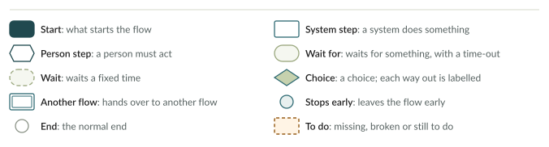

# Workflow diagrams: one library, one meaning

Toby, 25 Nov 2026 (D509, standards 24 in tmh-control-tower): "The key is that those diagrams remain consistent and
use onebase library so that they have a shared meaning and nomenclature." Every workflow diagram in TMH (Odoo SOPs,
GitHub, the vault, an app page) is drawn by this one renderer, from the system's own definition.



## The parts

| File | What it is |
| --- | --- |
| `step-kinds.json` | The ten kinds of step, each with its one shape, colour (brand tokens) and name. Nothing else defines a kind. |
| `flow.schema.json` | The neutral flow format: steps with a kind, a label, an optional note, tags, link and next steps. |
| `flow_diagram.py` | The renderer: flow JSON in, a plain SVG out. Python standard library only. |
| `legend.svg` | The key of every kind. Each diagram also carries a key of the kinds it uses. |
| `examples/` | Email's Welcome flow and an example using every kind, as JSON and SVG. |

## How a chat draws a diagram

1. Write a small adapter in your own repo that turns your system's definition (a Resend automation, an n8n workflow,
   an Odoo SOP) into the flow format. The words on the steps are yours; keep each label to three lines.
2. Run the renderer from the kit, at a release tag:

   ```bash
   python flow_diagram.py my-flow.json -o my-flow.svg
   ```

   The renderer is also published with the kit at https://herbalmaster.github.io/herbot-ui/diagrams/flow_diagram.py
   with `step-kinds.json` beside it. Download both into one folder; never edit your copy.
3. Keep the flow JSON and the SVG in your GitHub repo. In an Odoo SOP the SVG goes in as an image, uploaded by an
   administrator (an Odoo write on Toby's yes), with a line under it linking to its source in GitHub and the date.
   On a web page, put the SVG inline so its links work.

## What it guarantees

- **Fits A4 and an Odoo article:** always 676 px wide, 14 px labels and 12 px notes, so nothing is shrunk.
- **Plain SVG:** shapes and text only, no scripts, fonts to load or foreignObject, so it shows the same as an image,
  in print and inline. White background.
- **Refuses rather than squeezes:** an unknown kind, a loop back, more than three columns, a label over three lines,
  or anything that looks like a key, token or webhook address. Fold identical branches into one step with market
  tags (UK · US · EU), or move a branch into another flow (a "subflow" step).
- **Top to bottom:** the main way on goes straight down; each other way out takes the next column to the right, with
  its label beside the line.

## The step kinds

| Kind | Name on the key | Shape | Means |
| --- | --- | --- | --- |
| trigger | Start | deep teal rounded box | what starts the flow |
| action | System step | white box, teal edge | a system does something |
| person | Person step | white hexagon | a person must act |
| wait | Wait for | cream pill | waits for something, with a time-out |
| delay | Wait | cream pill, dashed | waits a fixed time |
| split | Choice | sage diamond | a choice; each way out is labelled |
| subflow | Another flow | box with a double edge | hands over to another flow |
| stop | Stops early | pale teal dot | leaves the flow early |
| end | End | white dot | the normal end |
| gap | To do | amber dashed box | missing, broken or still to do (the only amber) |

A new kind, shape or colour is a kit release from TMH Design System, asked for through the Control Tower; never
draw your own.
